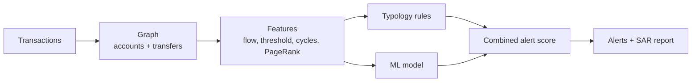

# ChainSentinel

**Anti-money-laundering detection on a blockchain transaction graph.**

ChainSentinel looks at on-chain transfers as a graph, finds accounts that behave like money
laundering, and explains each alert with the typology it matched. It combines three things:
**FATF-style rules** (the explainable part), an **ML model** (the learned part), and an
**LLM-written report** (the readable part). A human analyst reviews before any report is
filed.

> All transactions are **synthetic**. No real chain, wallet, or person is involved. The
> laundering patterns are injected on purpose so detection can be measured.

[](.github/workflows/ci.yml)
[](pyproject.toml)
[](LICENSE)

---

## Why it exists

Money laundering hides in the shape of the money flow: many small deposits funnelled into
one account, a lump moved fast through a chain, money that loops back to where it started,
one account splitting funds to many. Those shapes are visible in a transaction **graph**.
ChainSentinel builds that graph, measures each account, and raises an alert when the
behaviour matches a known typology or the model finds it suspicious.

## The typologies

| Typology | What it looks like |
|---|---|
| **Structuring (smurfing)** | Many deposits just under the reporting threshold into one collector |
| **Structuring source (mule)** | An account sending many under-threshold transfers to one place |
| **Layering** | A lump moved fast through a chain (money in ≈ money out, quickly) |
| **Round-tripping** | Money that returns to its origin (a cycle A → B → C → A) |
| **Fan-out** | One account splitting money to many |
| **Fan-in** | One account collecting from many and forwarding |

## How it works



* **Features.** Per account: money in and out, pass-through ratio, deposits just under the
  threshold, how fast money leaves, PageRank, clustering, and whether the account is in a
  short cycle.
* **Rules + model.** The FATF rules give explainable hits; the random-forest model gives a
  learned score. The alert score blends the two.
* **Report.** For the top alerts, a suspicious-activity report (SAR) draft is written —
  from a template, or by the LLM cascade — and a human reviews.

## Results on the synthetic set

```
model:  precision 1.00  recall 1.00  ROC-AUC 1.00 (on the held-out split)
alerts: precision 1.00  recall 1.00 on a fresh graph vs the injected labels
```

The synthetic set is clean by design, so the scores are high. Real data is far messier —
see "Honest limits".

## Quickstart

```bash
python -m venv .venv && source .venv/bin/activate
make install
make demo          # train, analyze a graph, print alerts + a SAR narrative
make test          # full test suite
make run           # serve the API on http://localhost:8000 (docs at /docs)
```

### The API

| Method | Path | What it does |
|---|---|---|
| `GET` | `/health` | Liveness check |
| `GET` | `/model` | Active model version and metrics |
| `POST` | `/analyze` | Analyze a list of transactions; get ranked alerts |
| `POST` | `/analyze/sample` | Analyze the built-in synthetic graph |

## Provider-agnostic LLM

The SAR narrative can be written by an LLM through a **provider cascade** (`chainsentinel/llm/`):
Anthropic, OpenAI, Gemini, DeepSeek, or a local Ollama model, with fallback. Set
`CS_REPORT_MODE=llm` and `CS_LLM_PROVIDERS`. The default is `template` (no LLM). The LLM only
writes the prose; the detection and the score come from the rules and the model.

## Project layout

```
chainsentinel/
  generate.py    synthetic transactions with injected laundering typologies
  graph.py       build the transaction graph (NetworkX)
  features.py    per-account graph and behavioral features
  typologies.py  FATF-style rules
  model.py       random forest suspicion score
  scoring.py     blend the rule score and the ML score
  report.py      SAR narrative (template or LLM)
  llm/           provider-agnostic LLM cascade
  service.py     the flow (features -> rules + model -> alerts -> reports)
  main.py        FastAPI endpoints
  cli.py         train / demo
```

## Testing and quality

* **12 tests** cover generation, features and the cycle signal, the typology rules, the
  model, scoring, the service (precision/recall), the API, and the LLM cascade. CI requires
  at least 80% coverage.
* `ruff` for lint, `bandit` and `gitleaks` for security.

See [`docs/architecture.md`](docs/architecture.md), the [ADRs](docs/adr/), and the Spanish
study guide in [`docs/estudio/`](docs/estudio/).

## Honest limits

The synthetic graph has clean, separable typologies, so the scores are near perfect. Real
chains have millions of accounts, mixers, exchanges, and normal activity that looks odd, so
precision and recall would be much lower and the thresholds would need careful tuning. The
value here is the method — graph features, explainable typologies, a learned score, and a
human in the loop — and a measurable baseline.

## License

[MIT](LICENSE) © Angelo David Padilla Romero
