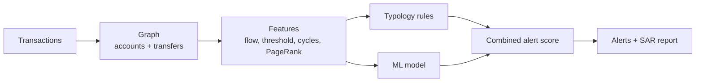

# ChainSentinel

**Anti-money-laundering detection on a blockchain transaction graph.**

ChainSentinel looks at on-chain transfers as a graph, finds accounts that behave like money
laundering, and explains each alert with the typology it matched. It combines three things:
**FATF-style rules** (the explainable part), an **ML model** (the learned part), and an
**LLM-written report** (the readable part). A human analyst reviews before any report is
filed.

> All transactions are **synthetic** — by necessity, not convenience. There is no public
> dataset of *raw, labelled* laundering transaction graphs (even the well-known ones, such
> as IBM's AML data, are themselves synthetic), so the graph is generated here. It is built
> to be **realistically hard**: alongside the injected laundering it contains legitimate
> accounts that *look* suspicious — payment intermediaries, refund loops, payroll runs,
> popular merchants, sub-threshold vendors, and money-services businesses that trip the same
> signatures a launderer does. Those confounders are the false-positive pressure a real AML
> system fights, and they are what stop the scores from being a meaningless 1.0.

[](.github/workflows/ci.yml)
[](pyproject.toml)
[](LICENSE)

---

## Why it exists

Money laundering hides in the shape of the money flow: many small deposits funnelled into
one account, a lump moved fast through a chain, money that loops back to where it started,
one account splitting funds to many. Those shapes are visible in a transaction **graph**.
ChainSentinel builds that graph, measures each account, and raises an alert when the
behaviour matches a known typology or the model finds it suspicious.

## The typologies

| Typology | What it looks like |
|---|---|
| **Structuring (smurfing)** | Many deposits just under the reporting threshold into one collector |
| **Structuring source (mule)** | An account sending many under-threshold transfers to one place |
| **Layering** | A lump moved fast through a chain (money in ≈ money out, quickly) |
| **Round-tripping** | Money that returns to its origin (a cycle A → B → C → A) |
| **Fan-out** | One account splitting money to many |
| **Fan-in** | One account collecting from many and forwarding |

## How it works



* **Features.** Per account: money in and out, pass-through ratio, deposits just under the
  threshold, how fast money leaves, PageRank, clustering, and whether the account is in a
  short cycle.
* **Rules + model.** The FATF rules give explainable hits; the random-forest model gives a
  learned score. The two are fused with a **noisy-OR** (`1 - (1-ml)(1-rule)`), not a weighted
  average: an average would dilute a confident model score when no rule happened to fire and
  silently miss real laundering. Noisy-OR means "suspicious if *either* source says so," so
  neither can veto the other.
* **Report.** For the top alerts, a suspicious-activity report (SAR) draft is written —
  from a template, or by the LLM cascade — and a human reviews.

## Results — measured on graphs the model never saw

Each "example" here is a *whole graph* (features like PageRank and cycle membership are
computed over the entire graph), so a row-wise split would leak. The detector is therefore
trained on one graph, its threshold is chosen on four separate **validation** graphs, and
it is scored on five independent **test** graphs with fresh seeds. Run it yourself with
`python -m chainsentinel.evaluate`:

```
alert threshold        : 0.81   (chosen on validation, never on the test graphs)

train graph (resubstitution — optimistic upper bound):
  P=0.923  R=1.000  F1=0.960  ROC-AUC=1.000  PR-AUC=0.997

independent test graphs [777, 888, 999, 1234, 2024] (never seen):
  precision: 0.946 +/- 0.038
  recall   : 0.992 +/- 0.017
  f1       : 0.968 +/- 0.015
  roc_auc  : 0.995 +/- 0.004
  pr_auc   : 0.918 +/- 0.067

generalisation gap (train F1 - mean test F1): -0.008   (no memorisation)
false positives: the money-services businesses — the hardest confounders
```

The numbers are **not** 1.0, and the small train-to-test gap is the point: the detector
generalises to unseen graphs rather than memorising one. The residual errors are
explainable (see "Limits"), not random.

## Quickstart

```bash
python -m venv .venv && source .venv/bin/activate
make install
make demo          # train, analyze a graph, print alerts + a SAR narrative
make test          # full test suite
make run           # serve the API on http://localhost:8000 (docs at /docs)
```

### The API

| Method | Path | What it does |
|---|---|---|
| `GET` | `/health` | Liveness check |
| `GET` | `/model` | Active model version and metrics |
| `POST` | `/analyze` | Analyze a list of transactions; get ranked alerts |
| `POST` | `/analyze/sample` | Analyze the built-in synthetic graph |

## Provider-agnostic LLM

The SAR narrative can be written by an LLM through a **provider cascade** (`chainsentinel/llm/`):
Anthropic, OpenAI, Gemini, DeepSeek, or a local Ollama model, with fallback. Set
`CS_REPORT_MODE=llm` and `CS_LLM_PROVIDERS`. The default is `template` (no LLM). The LLM only
writes the prose; the detection and the score come from the rules and the model.

## Project layout

```
chainsentinel/
  generate.py    synthetic transactions with injected laundering typologies
  graph.py       build the transaction graph (NetworkX)
  features.py    per-account graph and behavioral features
  typologies.py  FATF-style rules
  model.py       random forest suspicion score
  scoring.py     fuse the rule score and the ML score (noisy-OR)
  evaluate.py    leakage-aware evaluation: train/validation/test on separate graphs
  report.py      SAR narrative (template or LLM)
  llm/           provider-agnostic LLM cascade
  service.py     the flow (features -> rules + model -> alerts -> reports)
  main.py        FastAPI endpoints
  cli.py         train / demo
```

## Testing and quality

* **17 tests** cover generation and the confounders, features and the (ambiguous) cycle
  signal, the typology rules, the model, the noisy-OR fusion (with a regression guard against
  the diluting-average bug), the service precision/recall, the **generalisation to unseen
  graphs**, the API, and the LLM cascade. The fusion and confounder tests are mutation-proven:
  reverting the noisy-OR crashes recall to 0.17 and the test catches it. CI requires at least
  80% coverage.
* `ruff` for lint, `bandit` and `gitleaks` for security.

See [`docs/architecture.md`](docs/architecture.md), the [ADRs](docs/adr/), and the Spanish
study guide in [`docs/estudio/`](docs/estudio/).

## Limits (measured, not hidden)

- **The data is synthetic, and that caps realism.** Even with the confounders, a generated
  graph is more separable than a real chain with millions of accounts, mixers, and exchanges.
  The ROC-AUC (~0.995) is high because the *ranking* is easy on this data; the signal that matters
  is the **operating-point** precision/recall (~0.95 / ~0.99) and that they hold on graphs the
  model never saw. On real data both would be lower and the threshold would need re-tuning on
  labelled history.
- **One laundering shape is genuinely hard.** The fan-out distributor — a single large funding
  deposit split to many accounts — is structurally almost identical to a legitimate payroll run,
  so at a precision-respecting threshold it is sometimes missed. That is a real limitation of
  flow-shape features, not a bug; catching it reliably needs identity/KYC signals the graph
  alone does not carry.
- **No real-time, no adversary adaptation.** Launderers change behaviour once they learn the
  rules; this is a static baseline, not an adversarial model.

The value here is the method and a *measured, reproducible* baseline: graph features,
explainable typologies, a learned score fused without dilution, a threshold chosen without
touching the test set, and a human in the loop.

## License

[MIT](LICENSE) © Angelo David Padilla Romero
